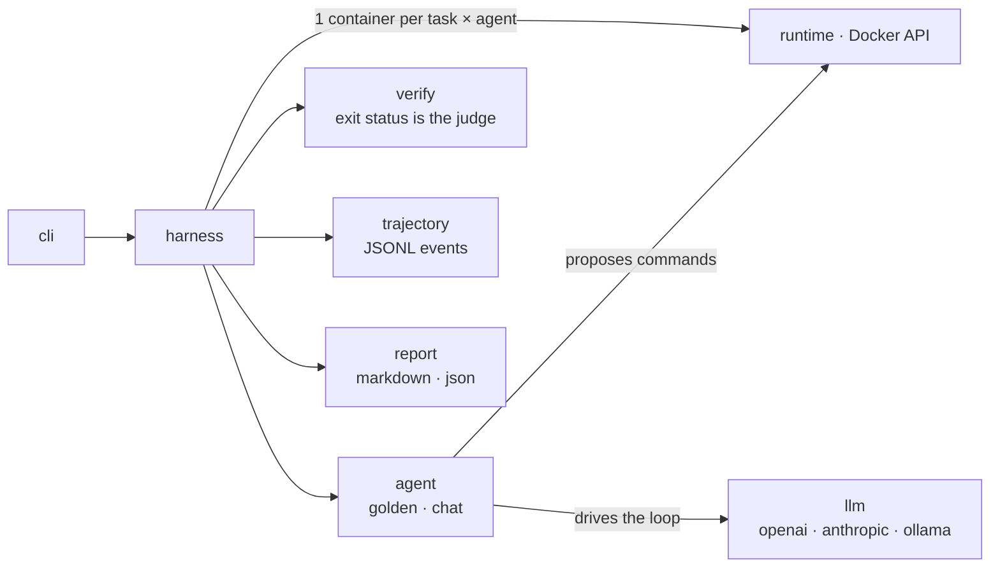

# evalrig

[](https://github.com/edxeme/evalrig/actions/workflows/ci.yml)
[](https://pkg.go.dev/github.com/edxeme/evalrig)
[](LICENSE)

**A Docker-backed harness for evaluating LLM coding agents.**
Tasks run in fresh containers, verifiers grade the outcome, every
attempt leaves a JSONL trajectory you can diff and analyze later.

## Why

Grading coding agents by hand does not scale and does not reproduce.
After months of running agent evaluations manually — rebuilding the
same setup each time: a container, a task, a script that decides
pass/fail — I wanted the loop to be a single command. evalrig is that
loop, built around the ideas that survived contact with real
benchmark work:

- **Fresh container per attempt.** No shared state, no lucky runs.
- **Golden solutions.** Every task ships a reference solution; if the
  golden run does not verify, the task is broken — not the model.
- **Verifiers are the only judge.** Exit status decides. Agent
  stdout/stderr is evidence, never the grade.
- **Trajectories as first-class output.** Every exec and model turn is
  recorded as JSONL for offline analysis.

## Quickstart

```bash
go install github.com/edxeme/evalrig/cmd/evalrig@latest

# validate and inspect a suite
evalrig validate --suite examples/suite.yaml
evalrig list     --suite examples/suite.yaml

# run the reference solutions end-to-end (needs Docker)
evalrig run --suite examples/suite.yaml --agents golden
```

Exit code is `0` only when every (task, agent) pair passes, so it
drops straight into CI.

### Driving a real model

Chat agents propose one shell command per turn inside the container;
evalrig executes it and feeds the output back until the model signals
`DONE` or the turn budget runs out:

```bash
# local models through Ollama's OpenAI-compatible endpoint
evalrig run --suite examples/suite.yaml --agents ollama --model qwen2.5-coder:7b

# hosted providers
OPENAI_API_KEY=...     evalrig run --suite examples/suite.yaml --agents openai
ANTHROPIC_API_KEY=...  evalrig run --suite examples/suite.yaml --agents anthropic
```

Compare agents by listing them: `--agents golden,openai,ollama` runs
the Cartesian product of tasks × agents with bounded concurrency and
writes one report with all of them.

## Suite format

```yaml
name: core-skills
version: 1
defaults:
  timeout: 5m
tasks:
  - id: fix-grep
    image: python:3.12-alpine
    dir: tasks/fix-grep
    files: files          # copied to /task
    prompt: prompt.md     # sent to chat agents
    golden: solution.sh   # reference solution
    verify:
      - verify.sh         # exit 0 = pass
```

Full reference, including the trajectory event catalog:
[docs/suite-format.md](docs/suite-format.md).

## Output layout

```
runs/20261026-093015/
├── report.md
├── report.json
└── traj/
    ├── fix-grep-golden.jsonl
    └── ...
```

```json
{"time":"2026-10-26T09:30:18.402Z","type":"exec_command","data":{"command":"python -m unittest discover -s tests -t ."}}
{"time":"2026-10-26T09:30:19.117Z","type":"exec_output","data":{"exit_code":0,"output":"OK"}}
```

## Architecture



## Design notes

- **Determinism over cleverness.** Same suite, same images, same
  verdict — the container is the only variable allowed to exist.
- **Bounded concurrency** with a fixed worker pool: N containers max,
  results reported in task order regardless of finish order.
- **Errors are not grades.** Infrastructure failures (daemon gone,
  timeout, bad image) surface as `error`, never silently as `fail`.
- **Small surface.** One binary, no daemon, YAML in, markdown + JSONL
  out.

## Roadmap

- [ ] Rubric-based grading alongside command verifiers
- [ ] Token accounting per attempt
- [ ] Sandbox runners beyond Docker
- [ ] Suite packaging and sharing

## License

[MIT](LICENSE) © Edwin Martínez
